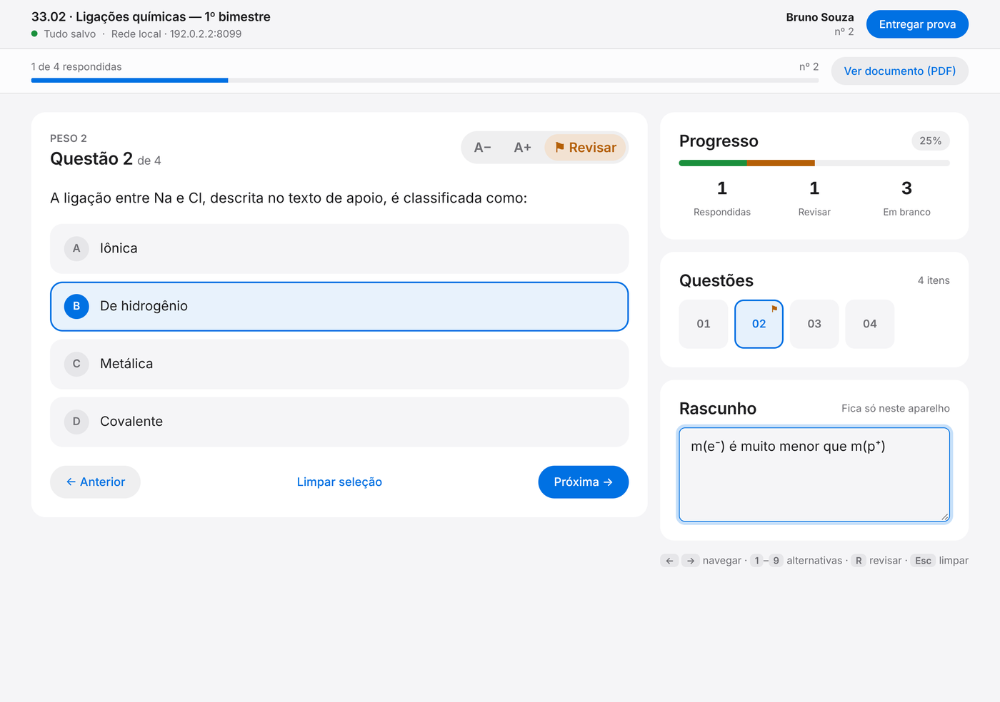
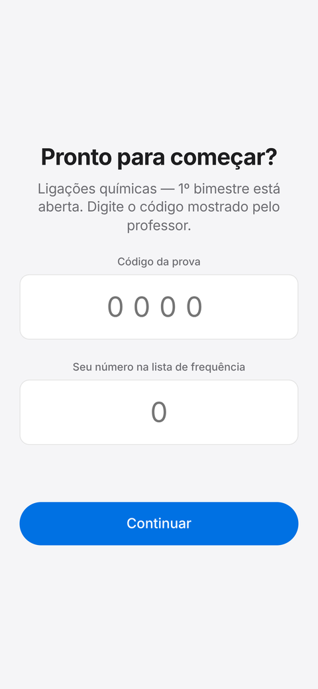
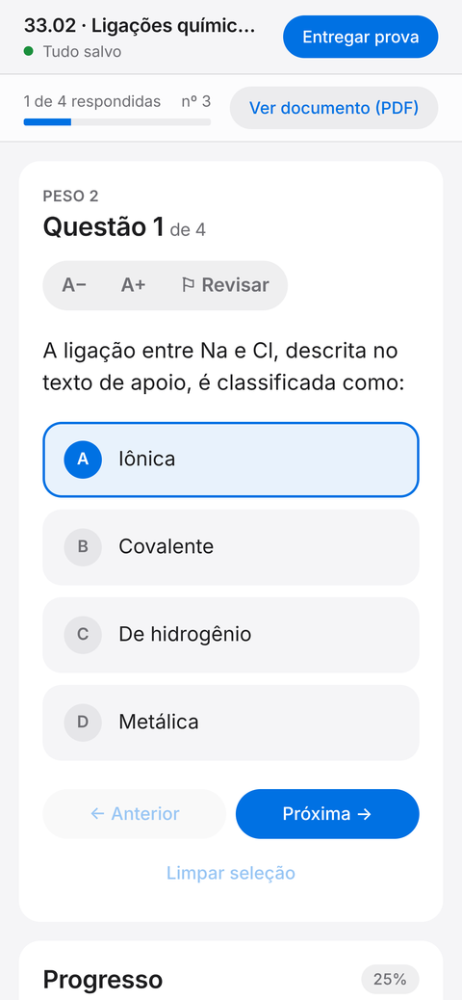
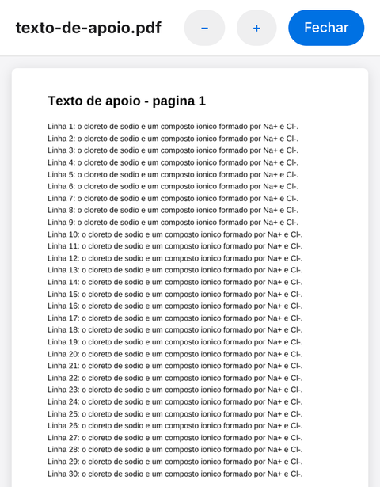
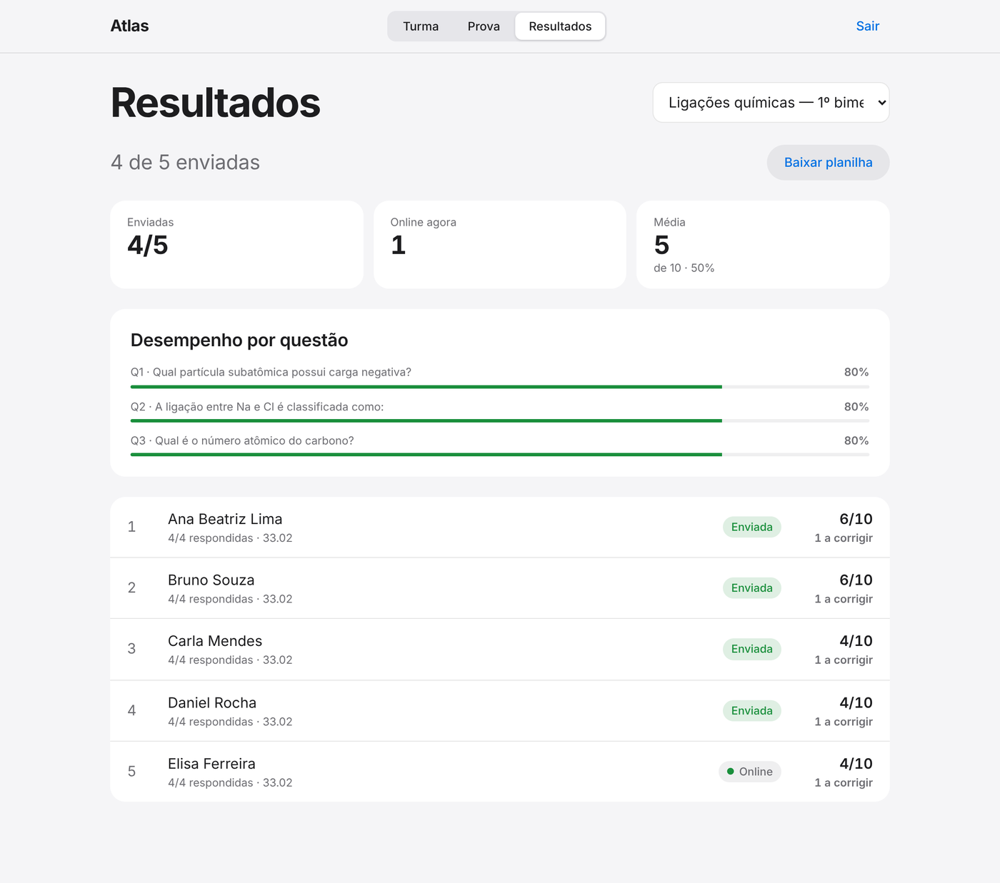
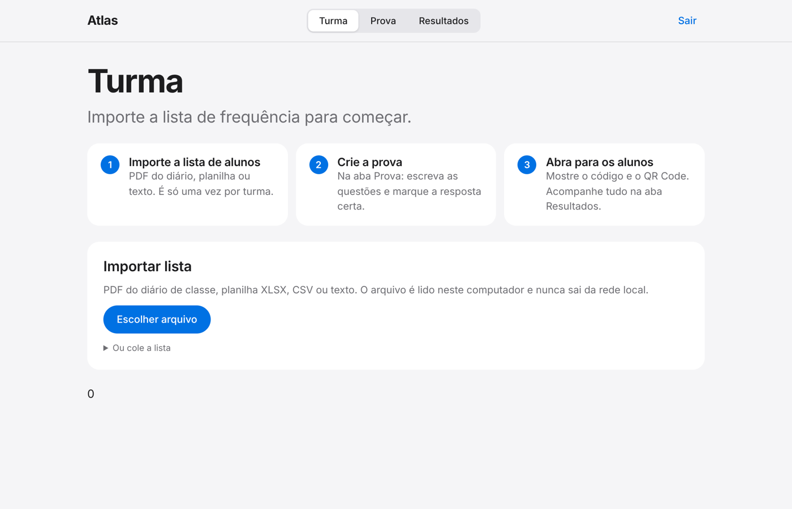
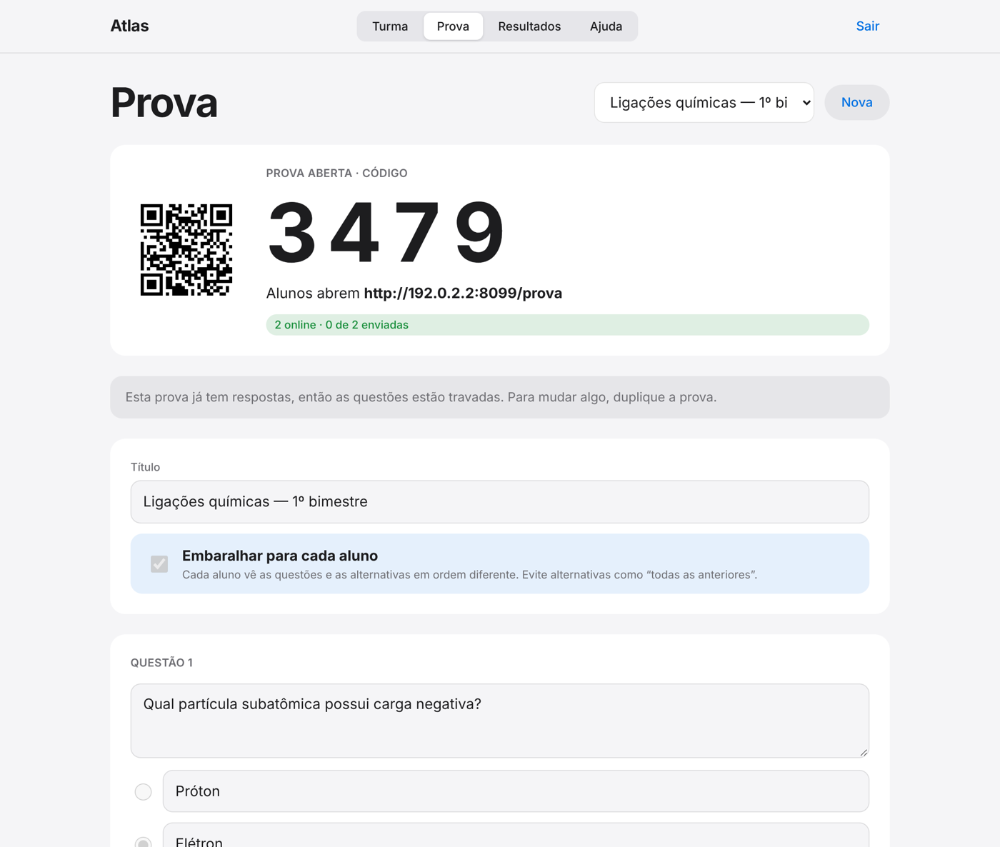

# Atlas — provas em rede local

O Atlas deixa você aplicar provas na sala de aula **sem Internet**. O seu computador funciona como "servidor": os alunos abrem a prova pelo navegador do celular, tablet ou Chromebook, conectados ao mesmo Wi‑Fi. Nada precisa ser instalado nos aparelhos dos alunos.

| Professor | Aluno |
| --- | --- |
| Importa a lista da turma, cria a prova (ou anexa um PDF/DOCX), abre com um código e acompanha as respostas ao vivo. A aba **Ajuda** testa a conexão e faz backup. | Digita o código e o número da lista, confirma o nome e responde **uma questão por vez**, com grade de questões, marcação para revisar e rascunho. As respostas são salvas a cada alteração, mesmo se o Wi‑Fi cair. |



<p>
  
  
  
</p>



> As imagens mostram dados de exemplo.

---

## Sumário

1. [O que você precisa](#1-o-que-você-precisa)
2. [Instalação (uma vez só)](#2-instalação-uma-vez-só)
3. [Dia a dia: aplicar uma prova](#3-dia-a-dia-aplicar-uma-prova)
4. [Como as notas funcionam](#4-como-as-notas-funcionam)
5. [Problemas comuns](#5-problemas-comuns)
6. [Segurança e privacidade](#6-segurança-e-privacidade)
7. [Dados, backup e atualização](#7-dados-backup-e-atualização)
8. [Para quem desenvolve](#8-para-quem-desenvolve)

---

## 1. O que você precisa

- Um **computador** (Windows, Mac ou Linux) que ficará ligado durante a prova.
- Um **roteador Wi‑Fi** (pode estar sem Internet). O computador e os aparelhos dos alunos precisam estar **na mesma rede**.
- **Internet apenas na primeira instalação**, para baixar o programa. Depois, funciona totalmente offline.
- O programa gratuito **Node.js** (o próprio Atlas ajuda você a instalá-lo, veja abaixo).

## 2. Instalação (uma vez só)

Você não precisa usar terminal, comandos nem saber programar.

### Caminho fácil: pacote pronto (não instala nada)

1. Abra a página **[Releases](../../releases/latest)** deste repositório (barra lateral direita, no GitHub).
2. Em **Assets**, baixe o arquivo do seu computador:
   - **Windows:** `Atlas-Windows.zip`
   - **Mac com chip Apple (M1, M2, M3…):** `Atlas-Mac-AppleSilicon.zip`
   - **Mac mais antigo (Intel):** `Atlas-Mac-Intel.zip`
   - **Linux:** `Atlas-Linux.zip`
3. Extraia o ZIP (botão direito → **Extrair tudo**) e guarde a pasta onde for fácil de achar, por exemplo em *Documentos*.
4. Dê dois cliques em **`Iniciar-Atlas`** (Windows) ou **`Iniciar-Atlas.command`** (Mac). No Mac, na primeira vez: botão direito → **Abrir** → **Abrir**.

Esse pacote já inclui tudo, inclusive o Node.js. Funciona **sem Internet**, mesmo na primeira vez.

### Caminho alternativo: baixar o código

Se ainda não há pacote na página Releases:

1. Nesta página, clique no botão verde **Code** → **Download ZIP** e extraia.
2. Dê dois cliques em `Iniciar-Atlas` (ou `Iniciar-Atlas.command`).
3. Se pedir o **Node.js**, o Atlas abre a página [nodejs.org](https://nodejs.org/): baixe o botão **LTS**, instale clicando em *Avançar* e dê dois cliques em `Iniciar-Atlas` de novo.
4. Na primeira vez, a janela preta mostra a preparação (alguns minutos, **com Internet**). Depois, o painel do professor abre sozinho no navegador.

> Se o Windows mostrar "O Windows protegeu o computador", clique em **Mais informações → Executar assim mesmo**. O arquivo apenas inicia o Atlas.
>
> Na primeira execução o Windows pode perguntar sobre o **Firewall**. Marque **Redes privadas** e clique em **Permitir acesso**. Sem isso os alunos não conseguem abrir a prova.
>
> No Mac, se aparecer um aviso sobre o arquivo `node` dentro da pasta `runtime`, abra **Ajustes do Sistema → Privacidade e Segurança** e clique em **Abrir mesmo assim**.

## 3. Dia a dia: aplicar uma prova

### Antes da aula

1. Dê dois cliques em `Iniciar-Atlas`. **Deixe a janela preta aberta** durante toda a aula; para encerrar, basta fechá-la.
2. O navegador abre em `/professor`. Digite o **PIN** que aparece na janela preta (6 números). O PIN é sempre o mesmo, fica guardado no arquivo `data/pin.txt`.

### Passo 1: Turma (só na primeira vez)

Na aba **Turma**, importe a lista de alunos. Aceita **PDF do diário de classe**, planilha **.xlsx**, **.csv** ou texto colado, no formato `número;nome;turma`. O Atlas mostra uma prévia: confira e clique em **Importar**.



### Passo 2: Prova

Na aba **Prova**:

1. Dê um **título**.
2. Escreva as questões. Em **múltipla escolha**, marque o círculo ao lado da alternativa correta para a correção ser automática. Use **Questão aberta** para respostas escritas.
3. Ajuste o **peso** de cada questão (a nota é a soma dos pesos).
4. *(Opcional)* **Anexe um PDF ou DOCX** com textos, figuras ou tabelas. O aluno abre o arquivo por um botão **Ver documento**, dentro da própria prova. O PDF é desenhado pelo Atlas, então aparece certinho em celulares e Chromebooks, com botões de zoom.
5. *(Opcional)* Marque **Embaralhar para cada aluno**: cada aluno vê as questões e as alternativas em ordem diferente (e a ordem não muda se ele recarregar a página). Evite alternativas como “todas as anteriores”.
6. Clique em **Salvar**.

**Atalho para colar várias questões de uma vez**, uma por linha, em "Colar várias questões em texto":

```text
Qual partícula tem carga negativa? | Próton | *Elétron | Nêutron
Explique a ligação iônica. || peso=2
```

A alternativa com `*` é a correta. `|| peso=2` define o peso (padrão 1).



### Passo 3: Abrir para os alunos

Clique em **Abrir para os alunos**. O painel mostra o **código de 4 números**, o **endereço** e um **QR Code**. Peça aos alunos que:

1. Conectem o aparelho ao Wi‑Fi da sala.
2. Abram o **QR Code** com a câmera (ou digitem o endereço mostrado, algo como `http://192.168.0.25:8080/prova`).
3. Digitem o **código** e o **número da lista de frequência**.
4. Confirmem o nome e respondam **uma questão por vez**. No computador, os atalhos são: `←` `→` navegar, `1`–`9` escolher a alternativa, `R` marcar para revisar, `Esc` limpar.
5. Ao final, tocam em **Entregar prova**. O Atlas avisa quais questões ficaram em branco ou marcadas para revisar.

**Na tela do aluno:** barra de progresso, grade para pular para qualquer questão, botões **A−/A+** para o tamanho da letra, **Revisar** (marcação só dele) e um **rascunho** que fica apenas no aparelho do aluno e não é enviado ao professor.

> Os alunos devem usar o endereço com números (o `192.168…`), **nunca** `localhost`.

### Passo 4: Resultados

Na aba **Resultados**, em tempo real:

- quantos alunos estão online e quantos já enviaram;
- a **média** da turma;
- o **desempenho por questão** (% de acerto e o erro mais comum), para ver o que a turma não aprendeu;
- a lista de alunos: toque em um nome para ver as respostas e **dar nota às questões abertas**;
- **Reabrir para o aluno**, caso alguém envie sem querer;
- **Baixar planilha**, um arquivo que abre direto no Excel, com acentos e vírgulas decimais corretos.

Para encerrar, volte à aba **Prova** e clique em **Encerrar prova**. Respostas já salvas são mantidas.

### Antes da primeira aula de verdade

Faça um teste com Internet desligada e alguns alunos fictícios: abra a prova em um aparelho, responda, desligue o Wi‑Fi por um minuto (aparece "Sem conexão" e as respostas ficam guardadas no aparelho), religue, envie e baixe a planilha.

### A aba Ajuda

- **Primeiros passos:** o guia de 5 passos, mais os botões **Criar prova de exemplo** e **Criar alunos de teste** (só funciona se a lista de alunos estiver vazia), para você ensaiar sem alunos de verdade.
- **Testar a conexão:** uma lista de verificação que se atualiza sozinha: o Atlas está funcionando, qual endereço os alunos devem usar (e se ele responde), se há prova aberta, se a turma foi importada e **quantos aparelhos de alunos já conectaram**. Se nenhum conectou, ela explica o que conferir (Wi‑Fi, Firewall).
- **Backup e restauração:** **Baixar backup agora** gera um único arquivo `.atlas` com turma, provas, respostas e anexos. **Restaurar de um backup…** devolve tudo a esse estado; antes da troca o Atlas guarda uma cópia do estado atual em `data/backups`.
- **Dúvidas frequentes.**

## 4. Como as notas funcionam

| Tipo de questão | Nota |
| --- | --- |
| Múltipla escolha **com** alternativa correta marcada | Automática: o peso inteiro ou zero |
| Múltipla escolha **sem** gabarito, ou questão aberta | Manual, de 0 até o peso da questão |

A nota aparece como `pontos/máximo`, junto com quantas respostas aguardam correção. O gabarito **nunca** é enviado ao aluno.

## 5. Problemas comuns

**Os alunos não conseguem abrir a página.**
Abra a aba **Ajuda → Testar a conexão** e, se precisar, confira nesta ordem: (1) o computador e os aparelhos estão no **mesmo Wi‑Fi**? (2) os alunos estão usando o endereço com números mostrado no painel, e não `localhost`? (3) a janela preta do Atlas continua aberta? (4) no Windows, libere o **Firewall** para **Redes privadas** ou a porta **8080** (Painel de Controle → Firewall do Windows → *Permitir um aplicativo*, marque Node.js). (5) algumas redes de escola bloqueiam a comunicação entre aparelhos: use um roteador próprio ou o "ponto de acesso" do celular.

**Esqueci o PIN.**
Abra o arquivo `data/pin.txt` com o Bloco de Notas. O PIN também aparece na janela preta ao iniciar.

**Aparece "A porta 8080 já está em uso".**
O Atlas já está aberto em outra janela. Feche-a e tente de novo.

**"Número não encontrado na lista".**
O aluno digitou um número que não está na turma importada. Confira a aba **Turma**.

**"Este número já está em uso em outro aparelho".**
Outro aparelho está usando o mesmo número agora. Se o aluno trocou de aparelho, espere cerca de 30 segundos e tente de novo.

**O aluno enviou sem querer.**
Em **Resultados**, abra o aluno e clique em **Reabrir para o aluno**.

**O PDF anexado não aparece no celular.**
O Atlas desenha o PDF dentro da prova, então deve aparecer (botão **Ver documento**). Se uma página falhar, o aluno pode tocar em **Abrir em outra aba**. Um **DOCX** também funciona.

**Importei a lista do diário em PDF e vieram nomes errados.**
A leitura de PDF depende do formato do diário. Se necessário, cole a lista como texto (`3;Nome do aluno`) ou use uma planilha.

**Preciso trocar a prova depois que alunos já responderam.**
As questões ficam travadas. Use **Duplicar** para criar uma cópia e alterar.

## 6. Segurança e privacidade

- O painel do professor exige **PIN** (sessão de 12 h, com limite de tentativas).
- O aluno precisa do **código da prova**. Um número já em uso em outro aparelho é bloqueado; ao recarregar a página, o mesmo aparelho continua de onde parou.
- Cada aluno envia a prova **uma única vez**; só o professor reabre.
- Textos dos alunos e documentos DOCX são exibidos com proteção contra código malicioso, e os arquivos enviados são validados pelo conteúdo.
- Nenhuma fonte, script ou imagem vem da Internet.
- Os dados dos alunos ficam **só neste computador**. **Nunca publique a pasta `data/`.**
- Limite conhecido: a rede da sala não usa HTTPS. Use um Wi‑Fi com senha própria e não compartilhe o código da prova fora da turma.

## 7. Dados, backup e atualização

Tudo fica na pasta `data/`: banco `atlas.sqlite`, anexos em `documents/`, o PIN em `pin.txt` e cópias automáticas em `backups/` (a cada 5 minutos, quando há mudanças, mantendo as 20 mais recentes).

- **Backup pelo painel (recomendado):** aba **Ajuda → Baixar backup agora**. Para voltar, **Restaurar de um backup…**.
- **Guardar uma aula inteira:** feche o Atlas e copie a pasta `data/` para um pendrive.
- **Atualizar o Atlas:** baixe o ZIP novo, extraia e **copie sua pasta `data/` antiga** para dentro da nova antes de iniciar.
- **Desinstalar:** apague a pasta do Atlas.

## 8. Para quem desenvolve

```bash
git clone https://github.com/nabikendo/socrative-search-lab.git
cd socrative-search-lab
npm install
npm run dev     # desenvolvimento com recarga automática (Vite)
npm test        # testes automáticos
npm start       # compila e inicia o servidor (porta 8080)
```

Requer Node.js **22.13+** (os pacotes prontos já trazem o Node.js). Variáveis opcionais: `PORT`, `ATLAS_PIN`, `ATLAS_DATA_DIR`.

```text
server.mjs        servidor HTTP, rotas e regras de acesso
lib/              banco SQLite (node:sqlite) e leitura de DOCX
shared/           regras de prova, notas, embaralhamento e leitura de listas (usadas no servidor e no navegador)
src/professor/    painel do professor (Turma, Prova, Resultados, Ajuda)
src/prova.js      tela do aluno, com fila offline
src/styles/       sistema de design (claro e escuro, sem fontes externas)
scripts/          verificação do Node e montagem dos pacotes prontos (package.sh)
.github/workflows publica os pacotes (Windows, Mac, Linux) na página Releases a cada versão `v*`
test/             testes da API
docs/             AUDIT.md (auditoria de segurança), ROADMAP.md (próximos passos)
```

### Publicar uma nova versão com os pacotes prontos

```bash
git tag v1.1.0 && git push origin v1.1.0
```

O GitHub Actions (`.github/workflows/pacotes.yml`) roda os testes, monta os pacotes para Windows, Mac (Apple e Intel) e Linux, com o Node.js dentro, e os anexa à página Releases. Também dá para rodar manualmente em **Actions → Pacotes prontos para usar → Run workflow**.
