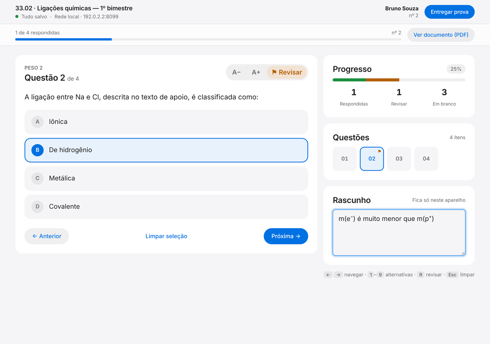
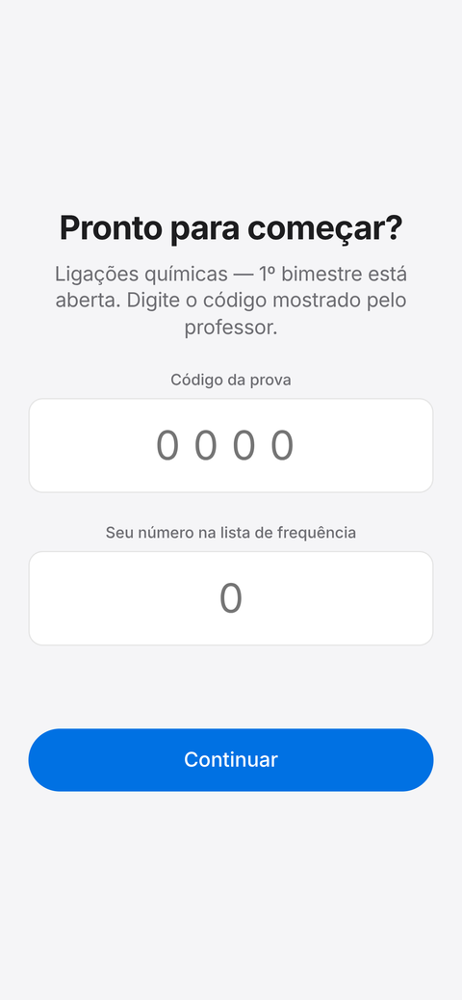
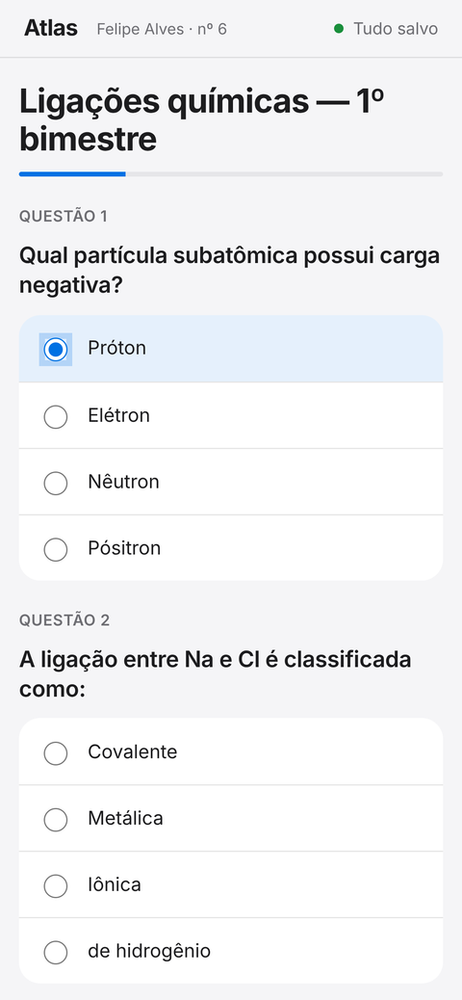
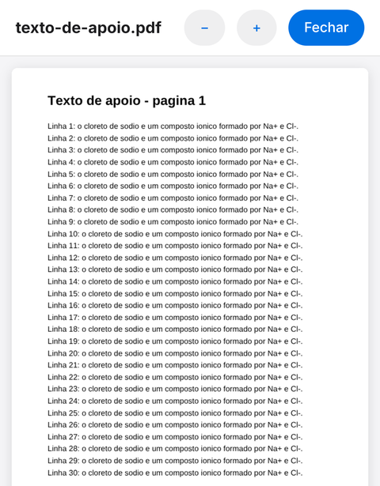
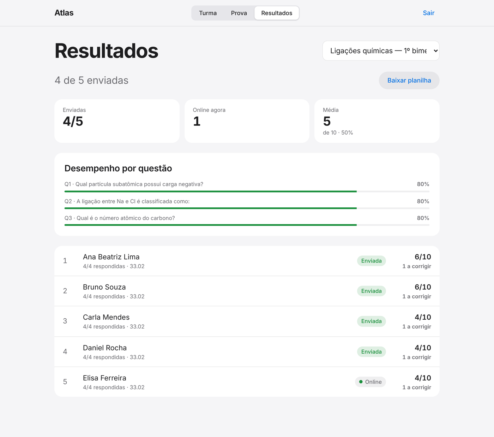
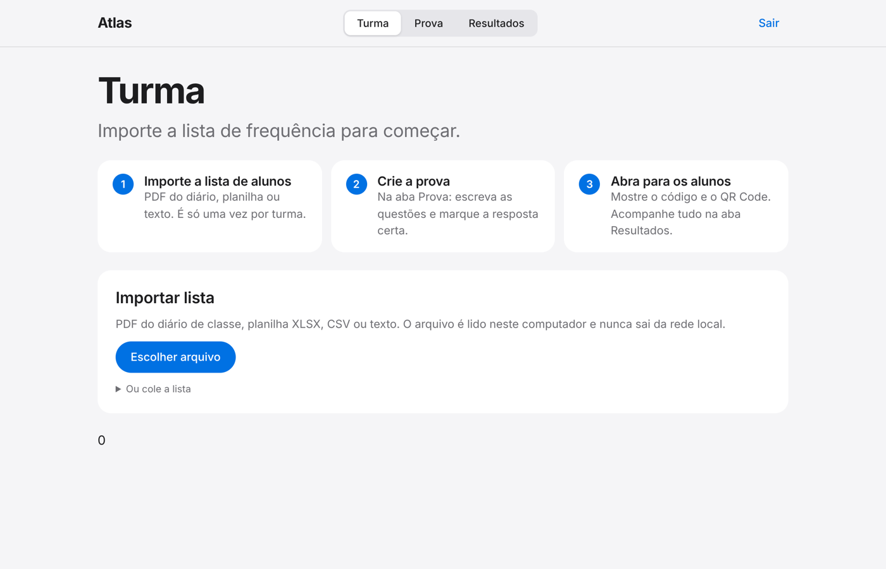
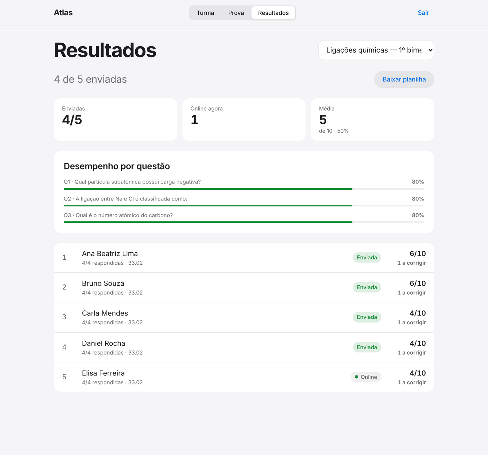

# Atlas — provas em rede local

O Atlas deixa você aplicar provas na sala de aula **sem Internet**. O seu computador funciona como "servidor": os alunos abrem a prova pelo navegador do celular, tablet ou Chromebook, conectados ao mesmo Wi‑Fi. Nada precisa ser instalado nos aparelhos dos alunos.

| Professor | Aluno |
| --- | --- |
| Mantém turmas e históricos separados, importa o Diário de Classe, reutiliza questões, relaciona itens a descritores do SAEB, abre provas e acompanha a turma ao vivo. Pode habilitar feedback imediato e relatórios individuais em PDF. | Digita o código e o número da lista, confirma o nome e responde **uma questão por vez**, com grade de questões, marcação para revisar e rascunho. As respostas são salvas a cada alteração, mesmo se o Wi‑Fi cair. |



<p>
  
  
  
</p>



> As imagens mostram dados de exemplo e são de versões anteriores; o visual atual é o da versão 1.4.0.

**Versão atual: 1.4.0** (estável). Aplicada e testada com turmas de até **40 alunos** ao mesmo tempo. Veja as [novidades da 1.4.0](#novidades-da-versão-140).

---

## Sumário

1. [O que você precisa](#1-o-que-você-precisa)
2. [Instalação (uma vez só)](#2-instalação-uma-vez-só)
3. [Dia a dia: aplicar uma prova](#3-dia-a-dia-aplicar-uma-prova)
4. [Como as notas funcionam](#4-como-as-notas-funcionam)
5. [Sala de aula com rede ruim](#5-sala-de-aula-com-rede-ruim)
6. [Problemas comuns](#6-problemas-comuns)
7. [Segurança e privacidade](#7-segurança-e-privacidade)
8. [Dados, backup e atualização](#8-dados-backup-e-atualização)
9. [Para quem desenvolve](#9-para-quem-desenvolve)
10. [Novidades da versão 1.4.0](#novidades-da-versão-140)
11. [Licença](#licença)

---

## 1. O que você precisa

- Um **computador** (Windows, Mac ou Linux) que ficará ligado durante a prova.
- Um **roteador Wi‑Fi** (pode estar sem Internet). O computador e os aparelhos dos alunos precisam estar **na mesma rede**.
- **Internet apenas na primeira instalação**, para baixar o programa. Depois, funciona totalmente offline.
- No **Windows**, só o instalador do Atlas. Nos pacotes ZIP e no código-fonte, o Atlas usa o **Node.js** (os pacotes já o trazem; veja abaixo).

## 2. Instalação (uma vez só)

Você não precisa usar terminal, comandos nem saber programar.

### Windows: instalador (recomendado)

1. Abra a página **[Releases](../../releases/latest)** e baixe **`Atlas-Setup-…-x64.exe`** (a versão estável mais recente).
2. Dê dois cliques no instalador. Se o Windows mostrar "O Windows protegeu o computador", clique em **Mais informações → Executar assim mesmo**.
3. Abra o **Atlas** pelo menu Iniciar. Na primeira vez ele pergunta se deve **liberar a rede para os alunos** (Firewall do Windows): clique em **Liberar agora** e aceite o aviso do administrador. Para refazer depois: menu **Atlas › Liberar no Firewall do Windows**.
4. O painel do professor abre na própria janela do Atlas, sem navegador e **sem janela preta**, e **sem pedir PIN neste computador**. Na primeira vez aparecem as **boas-vindas** com dicas (reveja em **Ajuda › Rever boas-vindas**). O **PIN** só é pedido quando o painel é aberto de outro aparelho da rede; ele está em **Atlas › Mostrar PIN do perfil principal**. Para exigir o PIN também neste computador: **Configurações › Segurança**.

O instalador já inclui tudo e funciona **sem Internet**. Para atualizar, veja a seção 8.

### Celular Android: aplicativo do aluno e do professor

Na página **[Releases](../../releases/latest)**, baixe **`Atlas-Android-…apk`** e instale (o Android pede para permitir a instalação de fontes desconhecidas). O aplicativo **não substitui o computador**: o Atlas continua rodando no computador do professor, e o celular só abre a prova ou o painel.

1. Conecte o celular ao Wi‑Fi do professor e abra o **Atlas**.
2. Toque em **Procurar na rede**: o aplicativo acha o computador do professor sozinho (ou digite o endereço mostrado na tela).
3. **Entrar na prova (aluno)** abre a prova; **Testar a conexão** confere a rede; **Painel do professor** abre o painel (PIN, resultados, downloads de planilha).

A tela fica acesa durante a prova, e o aviso de saída da página funciona normalmente (sair do aplicativo conta como sair da prova). O aplicativo só abre páginas do computador do professor. Requer Android 8 ou mais novo.

### Outros sistemas (ou Windows sem instalador): pacote pronto

1. Abra a página **[Releases](../../releases/latest)** deste repositório (barra lateral direita, no GitHub).
2. Em **Assets**, baixe o arquivo do seu computador:
   - **Windows (sem instalar):** `Atlas-Windows.zip`
   - **Mac com chip Apple (M1, M2, M3…):** `Atlas-Mac-AppleSilicon.zip`
   - **Mac mais antigo (Intel):** `Atlas-Mac-Intel.zip`
   - **Linux:** `Atlas-Linux.zip`
3. Extraia o ZIP (botão direito → **Extrair tudo**) e guarde a pasta onde for fácil de achar, por exemplo em *Documentos*.
4. Dê dois cliques em **`Iniciar-Atlas`** (Windows) ou **`Iniciar-Atlas.command`** (Mac). No Mac, na primeira vez: botão direito → **Abrir** → **Abrir**.

Esse pacote já inclui tudo, inclusive o Node.js 26 (LTS). Funciona **sem Internet**, mesmo na primeira vez.

### Caminho alternativo: baixar o código

Se ainda não há pacote na página Releases:

1. Nesta página, clique no botão verde **Code** → **Download ZIP** e extraia.
2. Dê dois cliques em `Iniciar-Atlas` (ou `Iniciar-Atlas.command`).
3. Se pedir o **Node.js**, o Atlas abre a página [nodejs.org](https://nodejs.org/): baixe o botão **LTS**, instale clicando em *Avançar* e dê dois cliques em `Iniciar-Atlas` de novo.
4. Na primeira vez, a janela preta mostra a preparação (alguns minutos, **com Internet**). Depois, o painel do professor abre sozinho no navegador.

> Se o Windows mostrar "O Windows protegeu o computador", clique em **Mais informações → Executar assim mesmo**. O arquivo apenas inicia o Atlas.
>
> Na primeira execução o Windows pode perguntar sobre o **Firewall**. Marque **Redes privadas** e clique em **Permitir acesso**. Sem isso os alunos não conseguem abrir a prova.
>
> No Mac, se aparecer um aviso sobre o arquivo `node` dentro da pasta `runtime`, abra **Ajustes do Sistema → Privacidade e Segurança** e clique em **Abrir mesmo assim**.

## 3. Dia a dia: aplicar uma prova

### Antes da aula

1. Dê dois cliques em `Iniciar-Atlas`. **Deixe a janela preta aberta** durante toda a aula; para encerrar, basta fechá-la.
2. O navegador abre em `/professor`. Digite o **PIN** que aparece na janela preta (6 números). O PIN é sempre o mesmo, fica guardado no arquivo `data/pin.txt`.

### Passo 1: Turma (só na primeira vez)

Na aba **Turma**, importe a lista de alunos. Aceita **PDF do diário de classe**, planilha **.xlsx**, **.csv** ou texto colado, no formato `número;nome;turma`. No Diário da SEDUC-TO, a turma do cabeçalho é aplicada aos alunos de todas as páginas. O Atlas mostra uma prévia e destaca números repetidos; confira antes de importar. Cada turma fica salva separadamente, e importar uma lista não apaga as outras.



### Passo 2: Prova

Na aba **Prova**:

1. Dê um **título** e escolha a **turma** da prova.
2. Escreva as questões. Em **múltipla escolha**, marque o círculo ao lado da alternativa correta para a correção ser automática. Use **Questão aberta** para respostas escritas.
3. Ajuste o **peso** de cada questão (a nota é a soma dos pesos).
4. Vincule opcionalmente um **descritor da Matriz de Matemática do SAEB**, escolhendo a etapa correta. O relatório agrupa acertos por etapa e descritor.
5. *(Opcional)* Ative **feedback após cada questão** e escreva uma explicação para mostrar ao aluno depois que responder.
6. *(Opcional)* **Anexe um PDF ou DOCX** com textos, figuras ou tabelas. Um PDF com texto selecionável também pode ser convertido em questões para revisão. Questões de PDFs escaneados como imagem precisam de OCR externo. O aluno pode abrir o documento durante a prova.
7. *(Opcional)* Marque **Embaralhar para cada aluno**: cada aluno vê as questões e as alternativas em ordem diferente (e a ordem não muda se ele recarregar a página). Evite alternativas como “todas as anteriores”.
8. Clique em **Salvar**.

Questões podem ser guardadas e reutilizadas na aba **Banco**. Em **Resultados**, acompanhe alunos online e baixe a planilha ou um relatório individual em PDF.

**Atalho para colar várias questões de uma vez**, uma por linha, em "Colar várias questões em texto":

```text
Qual partícula tem carga negativa? | Próton | *Elétron | Nêutron
Explique a ligação iônica. || peso=2
```

A alternativa com `*` é a correta. `|| peso=2` define o peso (padrão 1).



### Passo 3: Abrir para os alunos

Clique em **Abrir para os alunos**. O Atlas mostra um resumo para revisar e, ao confirmar, leva a tela até o **código de 4 números**, o **endereço** e o **QR Code**. **Abrir acompanhamento no projetor** abre uma janela própria com o código e os contadores, para mostrar à turma. Peça aos alunos que:

1. Conectem o aparelho ao Wi‑Fi da sala.
2. Abram o **QR Code** com a câmera (ou digitem o endereço mostrado, algo como `http://192.168.0.25:8080/prova`).
3. Digitem o **código** e o **número da lista de frequência**.
4. Confirmem o nome e respondam **uma questão por vez**. No computador, os atalhos são: `←` `→` navegar, `1`–`9` escolher a alternativa, `R` marcar para revisar, `Esc` limpar.
5. Ao final, tocam em **Finalizar e entregar**. O Atlas avisa quais questões ficaram em branco ou marcadas para revisar; tocar duas vezes em **Enviar** não duplica a entrega.

**Na tela do aluno:** barra de progresso, grade para pular para qualquer questão, botões **A−/A+** para o tamanho da letra, **Revisar** (marcação só dele) e um **rascunho** que fica apenas no aparelho do aluno e não é enviado ao professor.

> Os alunos devem usar o endereço com números (o `192.168…`), **nunca** `localhost`.

### Passo 4: Resultados

Na aba **Resultados**, em tempo real:

- quantos alunos estão online e quantos já enviaram, e **quem está fora da página da prova** agora (veja a seção 5);
- a **média** da turma;
- o **desempenho por questão** (% de acerto e o erro mais comum), para ver o que a turma não aprendeu;
- a lista de alunos: toque em um nome para ver as respostas e **dar nota às questões abertas**;
- **Reabrir para o aluno**, caso alguém envie sem querer: em poucos segundos a tela do aluno volta sozinha para a prova, com as respostas mantidas;
- **Baixar CSV** ou **Baixar XLSX**, que abrem direto no Excel, com acentos, vírgulas decimais e data e hora do seu computador (incluem as colunas de saídas da página);
- **Imprimir prova** e **Imprimir gabarito**, na aba Prova, para aplicar no papel se a rede falhar.

Para encerrar, volte à aba **Prova** e clique em **Encerrar prova** (ou deixe o horário de encerramento programado). Respostas já salvas são mantidas e uma cópia é guardada automaticamente (seção 5).

### Antes da primeira aula de verdade

Faça um teste com Internet desligada e alguns alunos fictícios: abra a prova em um aparelho, responda, desligue o Wi‑Fi por um minuto (aparece "Sem conexão" e as respostas ficam guardadas no aparelho), religue, envie e baixe a planilha.

### A aba Ajuda

- **Primeiros passos:** o guia de 5 passos, mais os botões **Criar prova de exemplo** e **Criar alunos de teste** (só funciona se a lista de alunos estiver vazia), para você ensaiar sem alunos de verdade.
- **Testar a conexão:** uma lista de verificação que se atualiza sozinha: o Atlas está funcionando, qual endereço os alunos devem usar (e se ele responde), se a porta é a padrão, se há prova aberta, se a turma foi importada, onde ficam as cópias automáticas e **quantos aparelhos de alunos já conectaram**. Se nenhum conectou, ela explica o que conferir (Wi‑Fi, Firewall).
- **Backup e restauração:** **Baixar backup agora** gera um único arquivo `.atlas` com turma, provas, respostas e anexos. **Restaurar de um backup…** devolve tudo a esse estado; antes da troca o Atlas guarda uma cópia do estado atual em `data/backups`.
- **Dúvidas frequentes.**

### Presença em tempo real (aba Resultados)

No topo da aba Resultados, o painel **Presença** mostra **“X de Y alunos entraram”** e separa a turma em **Entraram** (verde: em prova ou enviou; amarelo: saiu) e **Não entraram** (vermelho). Atualiza sozinho em segundos. Tem busca por nome ou número, **Exportar chamada** (CSV que abre no Excel), **Liberar dispositivo** para troca de aparelho sem perder respostas, alertas de pedido de ajuda e de aluno tentando entrar em dois aparelhos, e o registro com IP, entrada, saída e trocas.

Na prova, o aluno tem o botão **✋ Pedir ajuda**, avisos aos 5 e a 1 minuto do fim e, antes de enviar, a lista das questões em branco e marcadas para revisar.

### Configurações (ícone de engrenagem)

- **Geral:** tema, tamanho da fonte e padrões de prova.
- **Perfis** (aplicativo para computador): cada professor tem seu perfil, com turmas, alunos, avaliações, resultados, preferências e IA separados. Dá para criar, renomear, trocar o PIN, abrir e excluir perfis. Ao excluir, o Atlas oferece salvar uma cópia `.atlas` em `Documentos\Atlas\PerfisExcluidos`.
- **Inteligência artificial:** escolha qual IA elabora e qual analisa as questões (aba Descritores). A IA é sempre em nuvem (a local foi removida): ChatGPT, Claude, Gemini, DeepSeek, Groq, OpenRouter, Mistral, xAI ou qualquer serviço compatível com OpenAI funcionam com a sua chave de API. Use **Testar conexão** antes de salvar. A chave fica só neste computador (criptografada no aplicativo para Windows) e nunca é mostrada de novo. Com IA na nuvem, o enunciado, o descritor e o texto-base são enviados ao provedor; dados de alunos nunca são.
- **Segurança:** modo da rede (`http` com proteções, `auto` ou `https`), validade do acesso do aluno e o diagnóstico `/diag/https` para testar os Chromebooks antes de ligar o HTTPS.
- **Dados e limpeza:** backup, e limpeza com alcance individual (um aluno ou participante), por prova, por turma ou do perfil inteiro: avaliações em elaboração, reiniciar prova em andamento, desconectar participantes, apagar resultados, redefinir turmas e alunos, limpar cache, restaurar configurações, remover chaves de IA e restaurar o perfil de fábrica. Antes de apagar, o Atlas mostra o que será afetado, pede para digitar **APAGAR** e guarda uma cópia de segurança (as 10 mais recentes).
- **Modo de teste:** cria uma turma, provas e resultados fictícios num banco separado. Uma faixa amarela avisa que o modo está ativo; os dados reais não são lidos nem alterados, e backup, restauração e cópias automáticas ficam bloqueados enquanto ele estiver ligado. Não é possível ativá-lo com uma prova real aberta.

## 4. Como as notas funcionam

| Tipo de questão | Nota |
| --- | --- |
| Múltipla escolha **com** alternativa correta marcada | Automática: o peso inteiro ou zero |
| Múltipla escolha **sem** gabarito, ou questão aberta | Manual, de 0 até o peso da questão |

A nota aparece como `pontos/máximo`, junto com quantas respostas aguardam correção. O gabarito **nunca** é enviado ao aluno.

## 5. Sala de aula com rede ruim

O Atlas funciona sem Internet; o que costuma falhar é a rede da sala (e os Chromebooks da escola, que não aceitam instalar nada, mas abrem a prova pelo navegador). O que ajuda:

- **Roteador próprio:** o Wi‑Fi da escola muitas vezes impede que os aparelhos se enxerguem. Um roteador simples, sem Internet, resolve.
- **Teste dos alunos:** antes da prova, peça que abram o endereço do professor terminado em `/teste`. A página mede a conexão e avisa o professor que o aparelho chegou.
- **Endereço curto:** o Atlas usa a porta 80 quando possível, então o endereço fica só `http://192.168.x.x/prova`. Se a 80 estiver ocupada, usa a 8080 e o diagnóstico avisa; o QR Code sempre leva a porta certa.
- **Firewall do Windows:** na primeira abertura o Atlas oferece liberar a rede. Para refazer: menu **Atlas › Liberar no Firewall do Windows**.
- **Computador acordado:** com uma prova aberta, o Windows não entra em suspensão.
- **Saiu da página:** o aluno é avisado de que o professor sabe quando ele sai da prova. Em **Resultados** aparece “Fora da prova” em tempo real, quantas vezes saiu e por quanto tempo. Ao abrir o aluno, a lista mostra o horário de cada saída; os números também vão para a planilha e para o relatório individual. Nada é bloqueado no aparelho do aluno, e o Atlas só registra o fato de a página ter perdido o foco (nunca o que o aluno viu). É um sinal para conversar, não prova de colagem: abrir o PDF em outra aba também conta. Saídas muito curtas e saídas durante uma pausa não entram na conta.
- **Tempo restante:** quando a prova tem horário de encerramento, o aluno vê o tempo restante pelo relógio do computador do professor.
- **Cópia automática:** ao encerrar a prova (pelo botão ou pelo horário programado), planilha e backup vão para `Documentos\Atlas\Copias` (menu **Atlas › Abrir pasta das cópias de provas**). Se a pasta Documentos sincroniza com a nuvem, a cópia já sai do computador. O Atlas guarda as 40 cópias mais recentes e apaga as mais antigas.
- **Plano B no papel:** na aba **Prova**, **Imprimir prova** e **Imprimir gabarito**.
- **Antes de confiar numa prova valendo nota:** teste com um Chromebook da escola de verdade, desligando o Wi‑Fi por um minuto no meio da prova.

## 6. Problemas comuns

**Os alunos não conseguem abrir a página.**
Abra a aba **Ajuda → Testar a conexão** e, se precisar, confira nesta ordem: (1) o computador e os aparelhos estão no **mesmo Wi‑Fi**? (2) os alunos estão usando o endereço com números mostrado no painel, e não `localhost`? (3) o Atlas continua aberto no computador (no pacote ZIP, a janela preta precisa ficar aberta)? (4) no Windows, use **Atlas › Liberar no Firewall do Windows** (no pacote ZIP: Painel de Controle → Firewall do Windows → *Permitir um aplicativo*, marque Node.js). (5) algumas redes de escola bloqueiam a comunicação entre aparelhos: use um roteador próprio ou o "ponto de acesso" do celular.

**Esqueci o PIN.**
No instalador do Windows: menu **Atlas › Mostrar PIN do perfil principal**. No pacote ZIP: abra o arquivo `data/pin.txt` com o Bloco de Notas; o PIN também aparece na janela preta ao iniciar.

**Aparece "A porta 8080 já está em uso" (pacote ZIP).**
O Atlas já está aberto em outra janela. Feche-a e tente de novo. O instalador do Windows escolhe outra porta sozinho.

**O computador entrou em suspensão e os alunos caíram.**
Com uma prova aberta o Atlas impede a suspensão no instalador do Windows. No pacote ZIP, desative a suspensão do computador durante a aula.

**"Número não encontrado na lista".**
O aluno digitou um número que não está na turma importada. Confira a aba **Turma**.

**"Este número já está em uso em outro aparelho".**
O número fica vinculado ao primeiro aparelho que entrou. Se o aluno trocou de aparelho de verdade, em **Resultados › Presença** toque em **Liberar dispositivo** ao lado do nome dele: o novo aparelho entra com as respostas já salvas e o antigo perde o acesso.

**O aluno enviou sem querer.**
Em **Resultados**, abra o aluno e clique em **Reabrir para o aluno** (o Atlas pede o motivo, que fica no histórico). A tela do aluno volta sozinha para a prova em alguns segundos. Se ele já fechou a página, basta entrar de novo com o código e o número.

**A IA não gera a questão ou diz que o modelo foi desativado.**
Em **Configurações › Inteligência artificial**, use **Testar conexão**. Se o provedor tiver desativado o modelo, o Atlas mostra o substituto e o botão **Usar … e salvar**. Modelos "flash-lite" respondem em poucos segundos; modelos maiores podem demorar mais de um minuto.

**O PDF anexado não aparece no celular.**
O Atlas desenha o PDF dentro da prova, então deve aparecer (botão **Ver documento**). Se uma página falhar, o aluno pode tocar em **Abrir em outra aba**. Um **DOCX** também funciona.

**Importei a lista do diário em PDF e vieram nomes errados.**
A leitura de PDF depende do formato do diário. Se necessário, cole a lista como texto (`3;Nome do aluno`) ou use uma planilha.

**Preciso trocar a prova depois que alunos já responderam.**
As questões ficam travadas. Use **Duplicar** para criar uma cópia e alterar.

## 7. Segurança e privacidade

- O painel do professor exige **PIN** (sessão de 12 h, com limite de tentativas).
- O aluno precisa do **código da prova**. O número fica **vinculado ao primeiro aparelho** que entrar; outro aparelho só entra depois que o professor toca em **Liberar dispositivo** (aba Resultados › Presença). Ao recarregar a página, o mesmo aparelho continua de onde parou.
- **Rede controlada é obrigatória** (hotspot do professor ou Wi‑Fi só da turma, com senha). Em Configurações › Segurança você escolhe o modo `http` (padrão), `auto` ou `https`, e usa o diagnóstico `/diag/https` para testar os Chromebooks. Detalhes e riscos em [docs/AUDIT.md](docs/AUDIT.md).
- O acesso do aluno vence após **10 minutos sem sinal** (ajustável); o mesmo aparelho renova sozinho.
- Cada aluno envia a prova **uma única vez**; só o professor reabre.
- Textos dos alunos e documentos DOCX são exibidos com proteção contra código malicioso, e os arquivos enviados são validados pelo conteúdo.
- Nenhuma fonte, script ou imagem vem da Internet.
- Os dados dos alunos ficam **só neste computador**. **Nunca publique a pasta `data/`.** A cópia automática (`Documentos\Atlas\Copias`) contém nomes e respostas: se essa pasta sincroniza com a nuvem, cuide de quem tem acesso à sua conta.
- O aluno é avisado de que o professor vê quando ele sai da página da prova; só o horário, a contagem e a duração ficam guardados.
- No modo padrão (`http`) a rede da sala não usa criptografia: use um Wi‑Fi com senha própria e não compartilhe o código da prova fora da turma. Os modos `https` e `auto` fazem cada aparelho aceitar um aviso de certificado; teste nos Chromebooks da escola antes de usar.
- Tentativas repetidas de adivinhar números de alunos são barradas, sem travar a sala: até 40 alunos podem entrar ao mesmo tempo, mesmo que a rede os mostre com um único endereço.

## 8. Dados, backup e atualização

No pacote ZIP, tudo fica na pasta `data/`; no instalador do Windows, na pasta de dados do Atlas do seu usuário (`%APPDATA%\Atlas\data`). Dentro dela: banco `atlas.sqlite`, anexos em `documents/`, o PIN em `pin.txt` e cópias automáticas em `backups/` (a cada 5 minutos, quando há mudanças, mantendo as 20 mais recentes).

- **Backup pelo painel (recomendado):** aba **Ajuda → Baixar backup agora**. Para voltar, **Restaurar de um backup…**.
- **Guardar uma aula inteira:** feche o Atlas e copie a pasta `data/` para um pendrive.
- **Cópia de cada prova:** ao encerrar, planilha (`.csv`) e backup (`.atlas`) vão para `Documentos\Atlas\Copias`; as 40 mais recentes ficam guardadas.
- **Atualizar o Atlas:** na versão instalada para Windows, o Atlas procura atualizações sozinho (sem incomodar quando não há Internet); use **Atlas → Buscar atualizações** ou `Alt+U` para buscar na hora. O programa pergunta antes de baixar. Em **Atlas → Canal de atualizações** você escolhe entre *Somente versões estáveis* (padrão da versão estável) e *Pré-lançamentos beta*. Em versões portáteis, baixe o ZIP novo, extraia e copie sua pasta `data/` antiga para dentro da nova antes de iniciar.
- **Desinstalar:** apague a pasta do Atlas.

## 9. Para quem desenvolve

```bash
git clone https://github.com/nabikendo/socrative-search-lab.git
cd socrative-search-lab
npm install
npm run dev     # desenvolvimento com recarga automática (Vite)
npm test        # testes automáticos
npm start       # compila e inicia o servidor (porta 8080)
```

Requer Node.js **24 ou mais novo** (recomendado: **26 LTS**; os pacotes ZIP já trazem o Node 26, e o instalador do Windows traz o Electron 43, que embute o Node 24). Variáveis opcionais: `PORT`, `ATLAS_PIN`, `ATLAS_DATA_DIR`, `ATLAS_EXPORT_DIR` (pasta das cópias automáticas). Em vez de variáveis de ambiente, dá para criar um arquivo `atlas.env` ao lado do `server.mjs`, com linhas como `PORT=8080` e `ATLAS_PIN=123456`.

Scripts úteis: `npm test`, `npm run test:coverage` (cobertura de testes), `npm run dev:server` (reinicia sozinho ao salvar).

```text
server.mjs        servidor HTTP, rotas e regras de acesso
lib/              banco SQLite (node:sqlite) e leitura de DOCX
shared/           regras de prova, notas, embaralhamento e leitura de listas (usadas no servidor e no navegador)
src/professor/    painel do professor (Turma, Prova, Resultados, Ajuda)
src/prova.js      tela do aluno, com fila offline
src/styles/       sistema de design (claro e escuro, sem fontes externas)
scripts/          verificação do Node e montagem dos pacotes prontos (package.sh)
.github/workflows pacotes.yml publica os pacotes ZIP a cada tag `v*`; desktop-windows.yml gera o instalador do Windows
test/             testes da API
docs/             AUDIT.md (auditoria de segurança), ROADMAP.md (próximos passos)
```

### Publicar uma nova versão com os pacotes prontos

```bash
git tag v1.1.0 && git push origin v1.1.0
```

O GitHub Actions (`.github/workflows/pacotes.yml`) roda os testes, monta os pacotes para Windows, Mac (Apple e Intel) e Linux, com o Node.js dentro, e os anexa à página Releases. A publicação estável do instalador do Windows já dispara esse fluxo sozinha. Também dá para rodar manualmente em **Actions → Pacotes prontos para usar → Run workflow**.

### Publicar o aplicativo Android

O projeto fica em `android/` (Java, sem bibliotecas externas) e é compilado por `.github/workflows/android.yml` a cada mudança nessa pasta na branch `main`. Para anexar o APK à release da versão do `package.json`, use `[publish atlas apk]` na mensagem do commit ou rode o fluxo em **Actions → Atlas Android → Run workflow** marcando *publish*. A assinatura vem dos segredos `ATLAS_KEYSTORE_B64` e `ATLAS_KEYSTORE_PASSWORD` do repositório; guarde uma cópia da chave, pois sem ela as próximas versões não instalam por cima das anteriores.

### Publicar o instalador do Windows

O instalador (Electron) é gerado por `.github/workflows/desktop-windows.yml` a cada push na branch `main` que mexa no código. Ele roda os testes, empacota, abre o app empacotado para conferir o painel e só então publica, se a mensagem do commit tiver uma marca:

- `[publish atlas stable]` com versão `1.2.0` no `package.json`: cria a release estável (publica `latest.yml` e também `beta.yml`, para quem está no canal beta atualizar);
- `[publish atlas beta]` com versão `1.2.0-beta.N`: cria um pré-lançamento.

A versão precisa ser nova: o GitHub recusa uma tag que já existe, e o atualizador só oferece versões maiores.


## Novidades da versão 1.4.0

**Para o professor**
- **Entrada mais simples:** no computador do professor o Atlas abre direto, sem PIN; outros aparelhos da rede pedem o PIN. Boas-vindas com dicas na primeira vez.
- **Prova nova** já começa com o editor de questões; ao abrir a prova, a tela vai até o código e o QR Code; o **projetor** abre numa janela própria.
- **Excluir prova com respostas**, digitando EXCLUIR e com cópia de segurança opcional.
- **Turma:** importar e atualizar listas mostra entradas, saídas e mudanças de nome antes de salvar.
- **Inteligência artificial em nuvem** (Gemini, ChatGPT, Claude, DeepSeek, Groq, OpenRouter, Mistral, xAI ou serviço compatível com OpenAI): lista de modelos com busca, teste de conexão, aviso quando o provedor desativa um modelo e erros mostrados dentro da janela. A IA local foi removida.
- **Modo de teste** com faixa de aviso sempre visível; **Perfis** para professores diferentes no mesmo computador.
- **Planilhas** CSV e XLSX com data e hora locais.

**Para os alunos**
- Turmas de **até 40 alunos** entrando e entregando ao mesmo tempo, mesmo numa rede que mostra todos com um único endereço.
- **Pedir ajuda** sempre ao alcance no celular; Voltar e Enviar sempre visíveis na janela de entrega, mesmo com o teclado aberto.
- Prova reaberta pelo professor volta sozinha para a tela do aluno; respostas guardadas durante quedas de Wi‑Fi são enviadas ao reconectar.
- Uso completo pelo teclado (Chromebook): atalhos `1`–`9`, `R`, setas e foco direto em **Sim, sou eu**.

## Licença

Copyright (C) 2026 nabikendo.

O Atlas é software livre: você pode usá-lo, redistribuí-lo e modificá-lo nos termos da **GNU General Public License, versão 3** ou (a seu critério) qualquer versão posterior, publicada pela Free Software Foundation. Escolas e professores podem instalar e adaptar o Atlas gratuitamente; quem distribuir uma versão modificada deve publicar o código dessa versão sob a mesma licença.

O Atlas é distribuído na esperança de ser útil, mas **sem qualquer garantia**. Veja o texto completo em [LICENSE](LICENSE).
